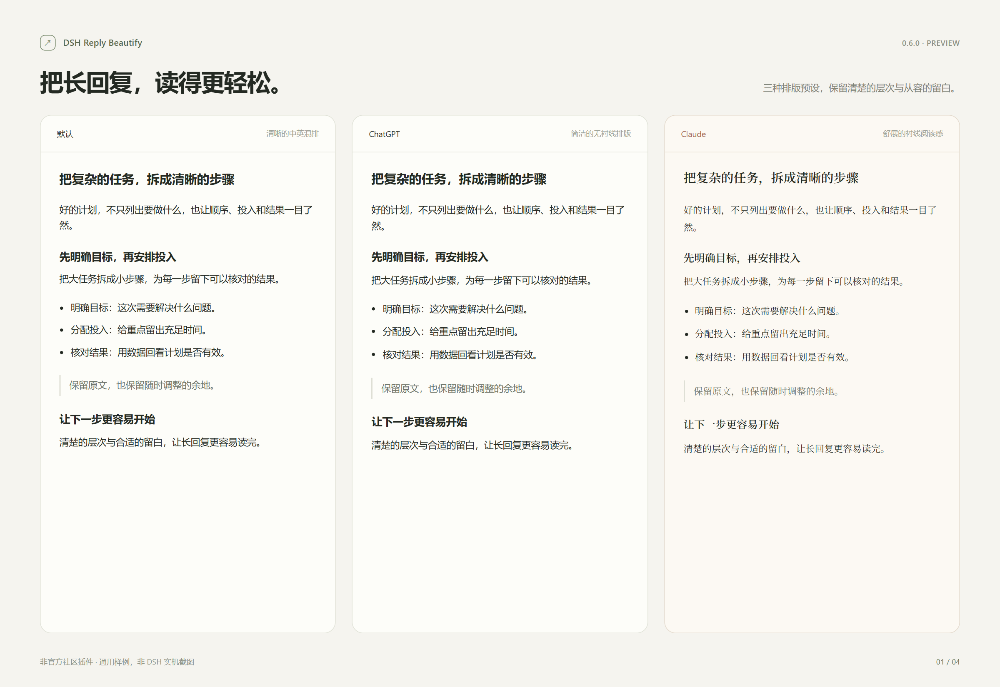
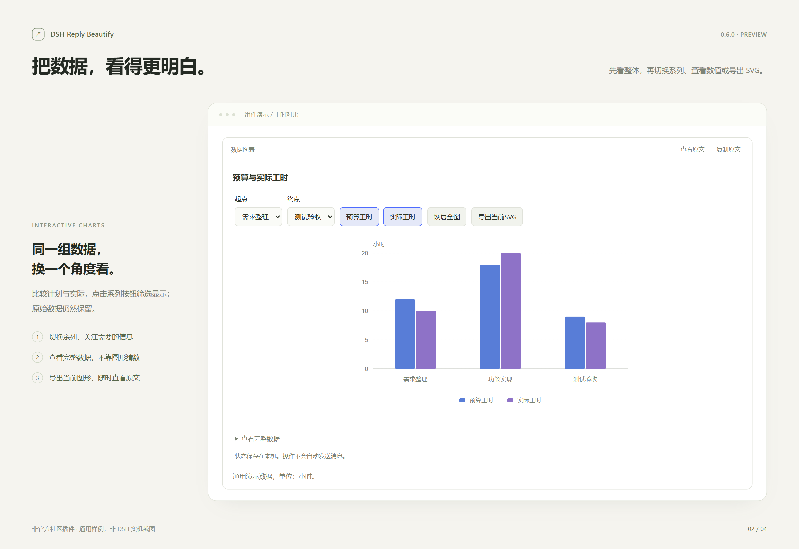
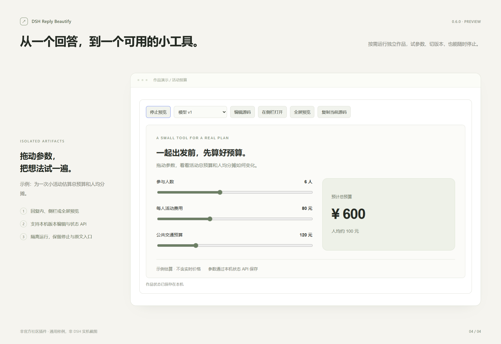

# DSH Reply Beautify · 回复美化

让 DeepSeek Harness 的助手回复更易读：三种排版风格、可操作的图表与表格，以及隔离的 HTML 小作品。保留 DSH 页面结构，随时查看原文。

**非官方社区插件 · MIT · 0.6.5 预发布** · [English](README.en.md) · [下载与 Release](https://github.com/ErSu137/dsh-reply-beautify/releases/tag/v0.6.5)

**0.6.1 更新**：更主动的可视化指引；普通比例图形完整适配，极端比例保留滚动；图上滚轮缩放，双击或“自动”恢复。短数字横轴的折线图更紧凑，保留全部数据。[使用与验收](docs/0.6.1.md)。模型仍可能不遵循指引，旧 ASCII 回复不会自动重绘。



上图为使用实际插件代码制作的通用样例。[查看全部六张演示图](docs/demo/README.md)：四张独立样例，以及两张已裁去账号与会话侧栏的 DSH 实机组件截图。图片来源均有标注。

下载当前源码后，可打开 `docs/demo/index.html` 浏览图片，或打开[交互样例](docs/demo/interactive.html)切换系列、修改输入和运行作品；无需账号，不连接模型。

已验收图片保留 0.6.0 时的展示；0.6.1 缩放可在交互样例中试用。

## 下载安装

适用于 **Windows DSH Desktop，接口兼容依据 0.2.1-rc.2**。默认路径及自定义路径支持同一套安装命令；自定义位置使用 `-Installation 'D:\DeepSeek Harness'`，检查、安装、卸载均可传入，详见[路径与版本检查](docs/安装更新与恢复.md#dsh-安装在-d-盘或其他目录)。其他平台和版本、最终视觉及长会话仍待验证；请先在专用测试对话验收。

1. 从 [Release](https://github.com/ErSu137/dsh-reply-beautify/releases/tag/v0.6.5) 下载 `dsh-reply-beautify-0.6.5.zip` 与 `SHA256SUMS-0.6.5.txt`。选择命名的安装包；GitHub 自动生成的 Source code 归档供开发者使用。
2. 用 `Get-FileHash .\dsh-reply-beautify-0.6.5.zip -Algorithm SHA256` 比对校验值，再解压至长期保留的文件夹，例如 `D:\Plugins\dsh-reply-beautify`。解压后进入包含 `install.ps1` 和 `package.json` 的内层目录。
3. 确保 DSH 至少启动过一次，然后通过“应用 → 退出”完全退出。在该目录打开 PowerShell：

   ```powershell
   powershell.exe -NoProfile -ExecutionPolicy Bypass -File .\install.ps1 -Check
   powershell.exe -NoProfile -ExecutionPolicy Bypass -File .\install.ps1
   ```

4. 重新启动 DSH，打开左下账户行的画笔，确认版本 **0.6.5**。在新建的测试对话试用。

`-Check` 只读，安装器调用安装目录内的官方 CLI，以 `link:`、`--offline --ignore-scripts` 添加插件，无需下载依赖。**插件持续从解压目录加载，不要移动或删除该目录。** 默认 profile 为 `%USERPROFILE%\.dsh\profiles\desktop`；设置了 `DSH_HOME` 时跟随该变量。备份保存在该插件目录的 `backups` 中，请勿上传。

详细操作、错误恢复与高级 tgz 用法见[安装、更新与恢复](docs/安装更新与恢复.md)。当前未发布 npm 包，也未提交到自定义插件市场。

## 能做什么

- **阅读排版**：默认、ChatGPT、Claude 三种预设；调正文字号、代码字号、行距、段间距。部分界面字体、字标及强调色随风格变化。Claude 普通强调色为橙色，轨迹保留紫、绿、金等语义色。
- **图示与计算**：可靠的 ASCII 字段图、关系图、部分 Mermaid TD/LR 流程图、数据图表及明确公式；交互图表、参数滑块与曲线、自测题、表单。
- **通用工具**：搜索/排序/编辑表格与 CSV 导出、计算器、加权方案比较、参数情景、时间轴/甘特/日历、清单/看板、层级、分步播放、分支向导、差异、来源卡片、联动报告。具体数量与格式上限见[格式与限制](docs/高通用性功能-格式与限制.md)。
- **作品空间**：按[作品格式](docs/第五阶段-作品格式.md)运行 HTML/CSS/JavaScript，支持回复内、侧栏、全屏预览，以及本机版本编辑。使用状态 API 的输入可以恢复。

直接提出任务即可，例如“比较甲乙丙预算工时 12、18、9 和实际工时 10、20、8，用图表展示”，或“用可调整输入的计算器比较投入成本”。插件给模型提供只读格式指南，模型自主选择组件，**不保证每次生成**。流式回复中，完整且校验通过的块可以先呈现，后文继续输出。无效或不支持的内容保留原文。

只增强助手正式回复，用户消息、推理和工具输出不参与组件转换；普通代码不会自动执行。来源、评分与题目答案来自模型，插件不替你核实事实。

## 功能演示





这两张是独立通用样例；[可编辑表格](docs/demo/03-table.png)、[DSH 实机图表](docs/demo/05-dsh-chart.png)和[实机参数曲线](docs/demo/06-dsh-curve.png)见完整画廊。图片验收不等于全部功能或跨平台验收。

## 更新、关闭与卸载

更新前保留旧版目录，下载新版到新目录；完全退出 DSH 后，在新目录运行安装脚本并重启。原有设置键保持兼容；回退时在保留的旧目录重新运行安装脚本。

| 操作 | 影响 |
| --- | --- |
| 画笔关闭“启用美化” | 恢复显示原文、停止预览；Host 中模型格式指南仍在 |
| DSH 插件管理停用 | 由框架停用客户端与 Host 能力；必要时完全退出并重启 |
| 完全退出后运行 `powershell.exe -NoProfile -ExecutionPolicy Bypass -File .\install.ps1 -Uninstall` | 官方 CLI 移除插件注册，变更前备份 profile 配置 |

上述操作均不主动删除本机偏好、交互和作品记录。备份不等于聊天备份；不要手动混合恢复单份 profile 配置。

## 数据与运行边界

偏好、交互数据、作品代码和 API 状态保存在本机 DSH 浏览器存储，可能含你输入的内容。普通持久状态最多 80 条/约 280000 字符，临时缓存 160 条/560000 字符；作品最多 12 个、各 6 版，总记录约 180 万字符，单份 API 状态 24000 字符。超限会淘汰旧记录；存储失败有提示，不承诺跨设备同步或永久保留。插件本身不自动发送消息或上传这些数据；DSH 发给模型的内容由 DSH 自身处理。

作品在双层不透明来源的 sandbox iframe 中运行，仅允许脚本；CSP 限制外部资源、连接和子框架。不提供文件、Node/Electron、聊天历史或工具桥梁。**隔离不能保证任意模型作品绝对安全，也不提供 CPU/内存硬限额**，忙循环仍可能卡顿。普通表达式只解析受限算术。CSV 已对危险前缀作文本转义，重新保存/导入的行为受表格软件影响。

复杂 Mermaid、循环/时序图等仍可能显示原文；公式复用 DSH 原生渲染。DOM 选择器与侧栏接口依赖 DSH 版本。ChatGPT/Claude 仅为风格参考，没有官方关联，也不打包字体或原应用资源。

## 验证与开发

本次维护更新：95 项 Node 测试、Windows PowerShell 5.1/PowerShell 7 各 54 项隔离安装断言，以及 15 项归档检查通过；真实安装内 CLI 在临时 profile 和默认/自定义目录别名下完成安装、自检、卸载。范围与限制见[发布检查报告](docs/RELEASE_CHECKS.md)。这不代表全平台、多版本或真实用户环境完整验收。[手工安装验收与周末测试清单](docs/TESTING.md)可直接照做。

无需安装运行依赖。开发用 Node 22+（本轮 24.19.0）、Python 3.9+ 和 PowerShell：

```powershell
node scripts/build.mjs
node --test tests/*.test.cjs tests/*.test.mjs
.\tests\installer.test.ps1
node scripts/build-demo.mjs
python scripts/package.py
python scripts/verify-release.py
```

可选浏览器检查使用 Playwright 和本机 Chromium，见 `scripts/check-browser.cjs`；不触碰 DSH。公开包采用明确清单，排除 profile、work、backups 和旧截图。[有限安全检查](SECURITY.md) · [第三方说明](THIRD_PARTY_NOTICES.md) · [变更记录](CHANGELOG.md) · [宣传草稿与发现渠道](docs/COMMUNITY.md)。历史阶段报告保留在 docs，历史数字不是本次验证结果。
