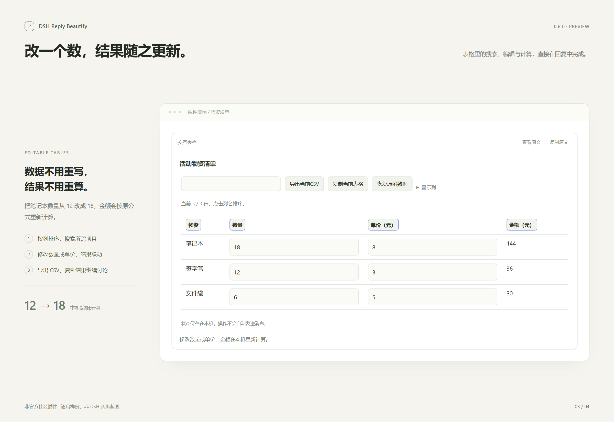
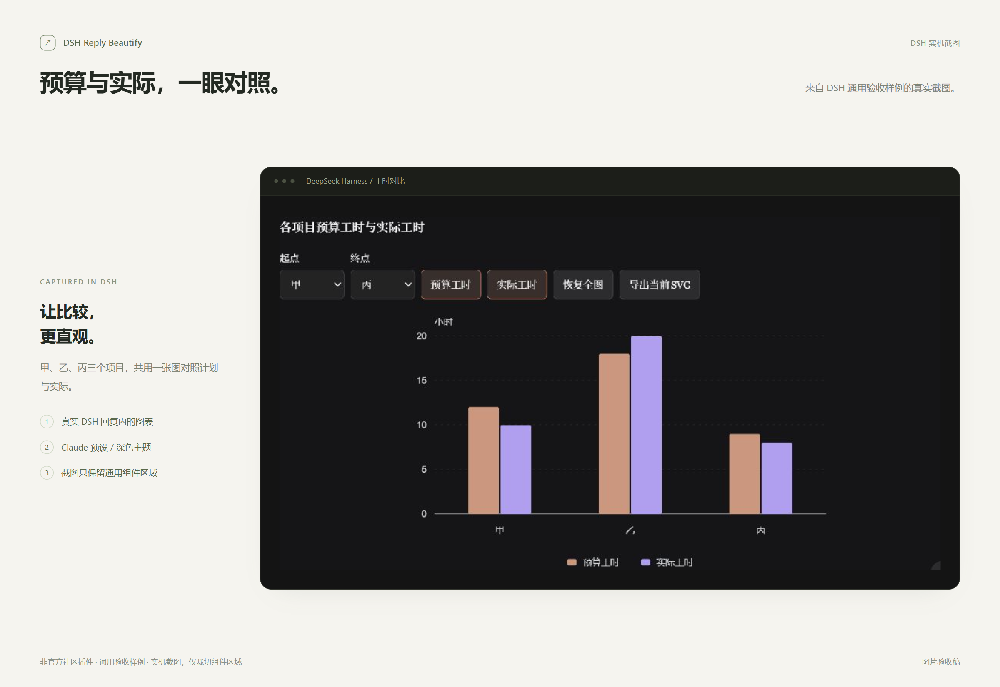
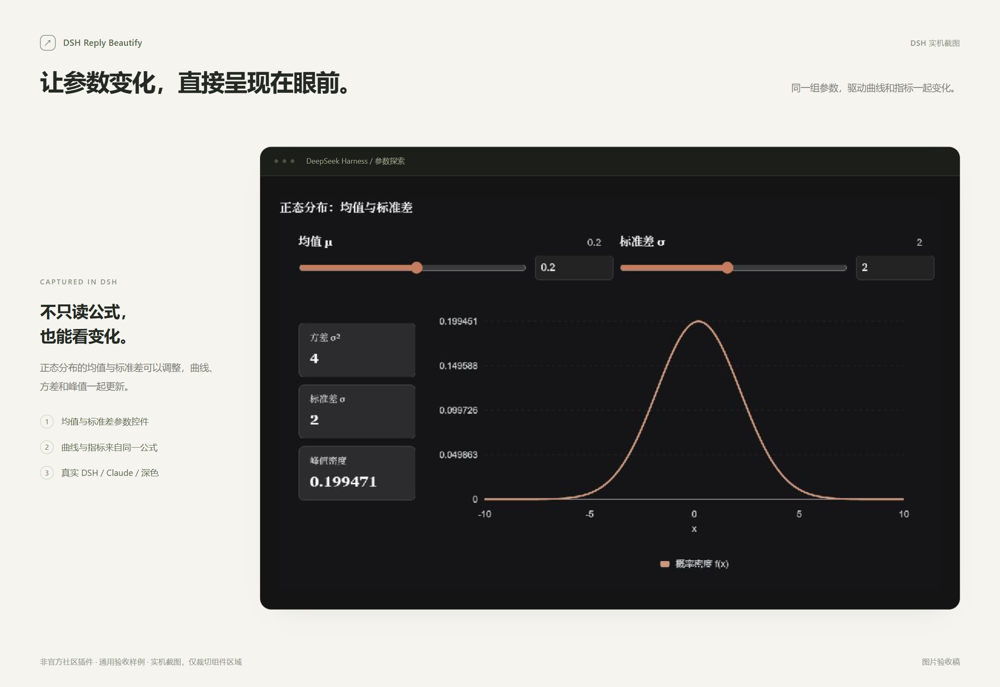

# 功能演示 / Screenshot gallery

六张图片已由项目维护者验收。四张独立通用样例与两张DSH实机截图分别标注，不代表完成全部功能、跨平台或多版本验收。

All six images were approved by the maintainer. Standalone samples and real DSH captures are labeled separately; image approval is not broad integration acceptance.

[中文说明](../../README.md) · [English](../../README.en.md) · [本地交互样例 / Local interactive demo](interactive.html)

## 阅读排版 / Typography

三种预设对照；独立通用样例。 / Standalone synthetic sample.

## 交互图表 / Interactive charts

工具栏与图形分区；独立通用样例。 / Standalone synthetic sample.

## 可编辑表格 / Editable tables

数量12→18，金额96→144；真实本机计算。 / Synthetic local editing example.

## 隔离作品 / Isolated artifacts

双层sandbox中的通用预算工具。 / Standalone synthetic HTML artifact.

## DSH 实机图表 / Chart in DSH

Claude预设、深色；通用验收组件截图，仅裁切组件区域。 / Cropped real DSH screenshot of a generic test component.

## DSH 实机参数探索 / Parameter explorer in DSH

Claude预设、深色；通用验收组件截图，仅裁切组件区域。 / Cropped real DSH screenshot of a generic test component.

