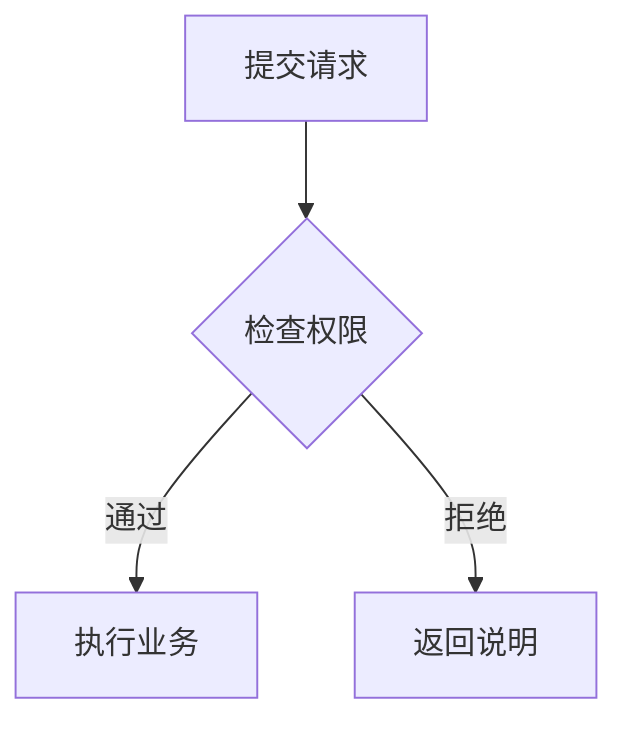

# 第三阶段：可用格式与示例

开启美化后自动处理助手正式回复内的可识别内容，原消息不会改写。图示上方可“查看原文 / 返回图示”“复制原文”；流程与数据图表还可导出 SVG。复制失败会展开可手动复制的原文。关闭总开关恢复 DSH 原生显示。

## 已有文本图

支持由 `+---+` 边界和 `|` 单元格构成的完整矩形字段图，以及空 / text / plaintext / ascii 围栏中的明确箭头流程，例如：

```text
+--------------+--------------+
| 源端口 (16)  | 目的端口 (16) |
+--------------+--------------+
|        序号 seq (32)        |
+-----------------------------+
|        确认号 ack (32)      |
+-----------------------------+
```

```text
需求 → 方案 → 实施 → 验收
```

```text
输入
↓
处理
↓
输出
```

字段图保留多行字段、图外行注释和首尾说明。只在分隔结构完整、每节各行列数一致时转换；行内程序语句等会使识别回退。ASCII 图的宽度来自文字布局，**不据此推断真实位数或补全协议字段**。需要按位宽显示时用下面的结构化字段格式。Unicode 框线和含糊箭头、任意树形 / 时序文本不在这一版自动转换范围。

## Mermaid 流程

可以直接对模型说：“流程图请用 Mermaid 的 flowchart TD 或 LR，节点文字保持简短。”



支持 `flowchart` / `graph`，TD / TB / LR 方向，矩形 `[文字]`、圆角 `(文字)`、判断 `{文字}`，`-->` 及 `-->|标签|` 连线和链式连线。最多 30 节点、50 连线。

不支持循环、子图、时序图、样式和点击脚本指令；这些情况保留完整原文，避免只画出部分流程。流程节点中的公式标记目前作为文字显示；独立数学公式按下文处理。

## 结构化字段和关系图

围栏语言使用 `dsh-diagram`，内容必须是完整 JSON。可以把示例直接交给模型参考。

```dsh-diagram
{"type":"fields","title":"记录字段（每行32位）","rows":[{"cells":[{"label":"类型","bits":8,"tone":"accent"},{"label":"编号","bits":24}]},{"cells":[{"label":"长度","bits":16},{"label":"校验","bits":16}]}]}
```

`rows` 最多 24 行，每行最多 16 格；`label` 是字段文字。`bits` 可省略，同一行需全部提供或全部省略；提供时必须为 1–1024 的整数，各有位数的行合计需相同。显示宽度按提供的位数分配，位数不一致则回退。没有位数时等分。`tone` 可为 `plain`、`accent`、`muted`。行说明可用 `note`。

```dsh-diagram
{"type":"flow","title":"从资料到结论","direction":"TD","nodes":[{"id":"input","label":"资料与问题","shape":"round"},{"id":"analysis","label":"分析与验证","tone":"accent"},{"id":"result","label":"结论与建议","tone":"muted"}],"edges":[{"from":"input","to":"analysis"},{"from":"analysis","to":"result","label":"核对后"}]}
```

节点 `id` 唯一，`shape` 可为 `box`、`round`、`decision`；方向 TD / LR。连线必须指向已有节点；循环回退。可选 `description` 提供图下说明。不接受任意 HTML、JS、外链资源或自定义可执行图形代码。

## 静态数据图表

围栏语言使用 `dsh-chart`。标签、系列、数值与单位须由模型依据已有数据明确给出，插件不补造。

```dsh-chart
{"type":"bar","title":"项目工时","unit":"小时","labels":["甲","乙","丙"],"series":[{"name":"预算","values":[12,18,9]},{"name":"实际","values":[10,20,8]}]}
```

```dsh-chart
{"type":"line","title":"阶段变化","unit":"件","labels":["阶段一","阶段二","阶段三"],"series":[{"name":"计划","values":[0,10,20]},{"name":"变化","values":[-3,8,14]}]}
```

支持柱状图 / 折线图、1–24 个分类标签、1–4 组数据、零和负数。每组数据长度须与标签数一致，数值必须有限且绝对值不超过 10¹²。轴含零基线；X 轴为分类轴，不冒充连续时间或数值轴。悬停可见精确值，“查看数据”展开同源表格；导出 SVG 保留轴、颜色及系列图例。可选 `description` 说明数据口径或来源。

## 数学、代码、表格与图片

DSH 已能处理规范的数学标记和 `math` 围栏，优先保留其能力。插件兼容 `latex` / `tex` 围栏和独立 `\[ ... \]` 段落；用同一个原生数学渲染器显示，确认成功才隐藏原文，失败继续显示原文。

```latex
\frac{1}{n}\sum_{i=1}^{n}(x_i-\bar{x})^2
```

普通文字中的 `2^k` 不会被全局改写。Python、JavaScript、JSON 等有明确语言标签的代码保持原生高亮、复制和换行行为；表格继续沿用既有排版与原生公式。对独立图片，只把已有且有意义的 alt 说明显示在图下，不生成或猜测描述，不新增网络请求，不改变图片点击行为。

## DSH 版本兼容

DSH 0.2.1 对未知围栏语言可能显示通用“代码块”，页面不保留原语言标签。因此插件也在无明确语言的块中识别 `flowchart` 声明、带 `type + nodes/edges/rows` 的完整图示对象，以及带 `type + labels + series` 的完整图表对象。明显的 TeX 命令开头也可识别。一般 JSON 对象不会触发转换，明确标记为 JSON 的代码块不会触发。

这不是完整 Mermaid 引擎或任意 HTML 作品预览。选择题、滑块、动态图形和模型调用约定属于第四阶段。
